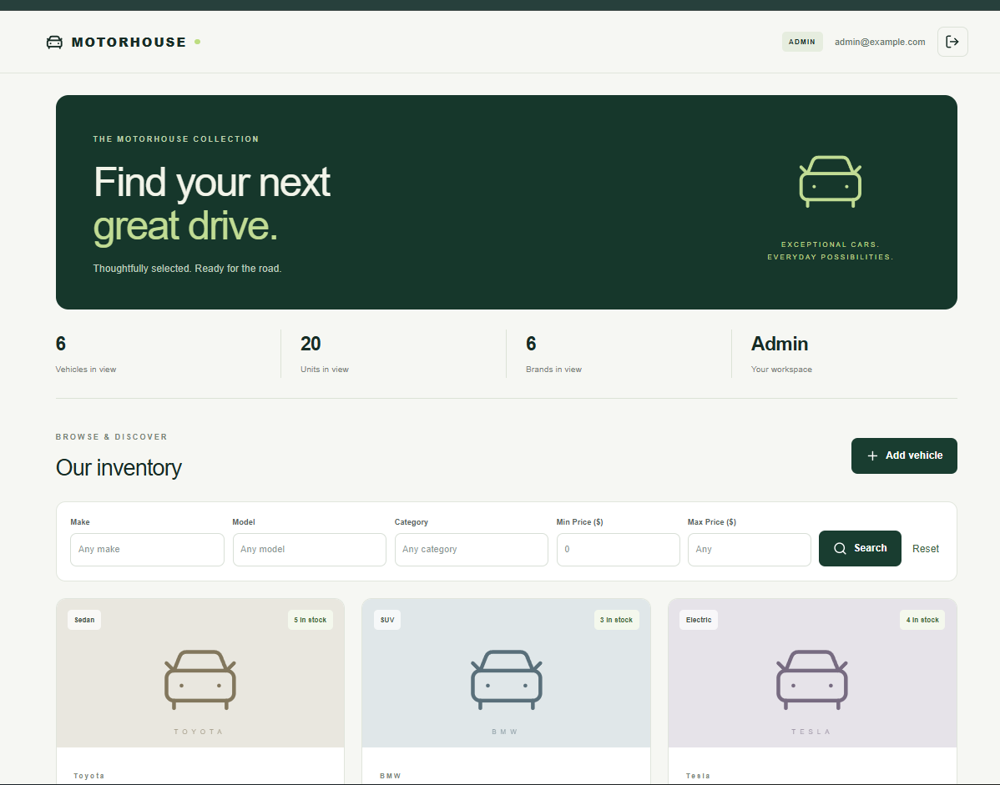
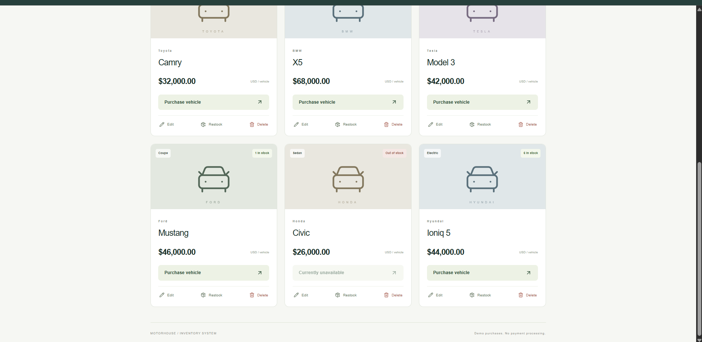
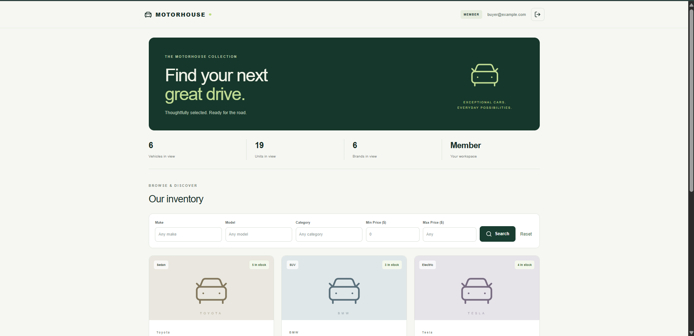
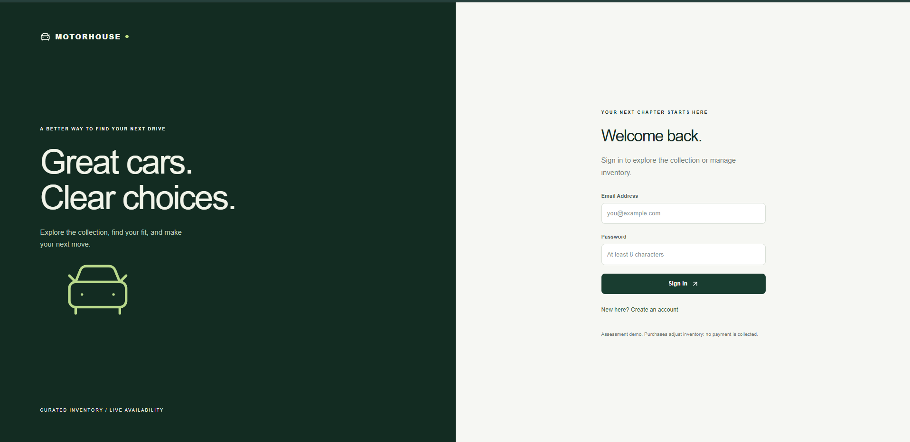

# Motorhouse - Car Dealership Inventory System

A full-stack car dealership inventory application built for the Incubyte assessment.

Members can register, search inventory, and purchase available vehicles.
Administrators can create, edit, delete, and restock vehicles.
Purchases update inventory only; no payment is collected.

## Technology

- Python 3.12, FastAPI, SQLAlchemy, file-backed SQLite
- JWT authentication and Argon2 password hashing
- React, Vite, Tailwind CSS, custom CSS, Lucide icons
- pytest, FastAPI TestClient, pytest-cov

## Features

- Registration and login with input validation.
- Password hashing and protected API endpoints.
- Vehicle inventory with make, model, category, price, and quantity.
- Case-insensitive make, model, and category search.
- Minimum and maximum price filters.
- Admin-only creation, editing, deletion, and restocking.
- Conditional database updates prevent purchasing below zero stock.
- Disabled purchase buttons for unavailable vehicles.
- Responsive interface with loading, empty, error, and success states.
- Delete confirmation and administrator setup script.

## Setup - Windows PowerShell

Prerequisites: Python 3.12, Node.js 24, npm, and Git.

### 1. Clone and install backend dependencies

```powershell
git clone https://github.com/arnabsinha01/incubyte-car-dealership.git
cd incubyte-car-dealership
python -m venv .venv
& .\.venv\Scripts\python.exe -m pip install -r backend\requirements-lock.txt
```

### 2. Create an administrator and sample inventory

Run from the repository root:

```powershell
& .\.venv\Scripts\python.exe -m backend.seed
```

Enter an email such as admin@example.com and choose a password with at least
eight characters. The email is a local login identifier; no email is sent.

The script creates an administrator and adds six sample vehicles when the
inventory is empty. It refuses to overwrite an existing account.
No administrator password is committed.

Members register through the frontend. Public registration cannot grant
administrator privileges.

### 3. Start the backend

```powershell
& .\.venv\Scripts\python.exe -m uvicorn backend.app:create_app --factory --host 127.0.0.1 --port 8000
```

Keep this terminal running.

- API: http://127.0.0.1:8000
- Interactive API documentation: http://127.0.0.1:8000/docs

### 4. Start the frontend

Open another PowerShell window in the repository root:

```powershell
cd frontend
npm.cmd ci
npm.cmd run dev
```

Open http://127.0.0.1:5173.

Sign in with the administrator credentials created above, or register a
member account. Vite forwards /api requests to the backend on port 8000.

### Build the frontend

From the frontend directory:

```powershell
npm.cmd run build
```

Output is written to frontend/dist. Hosting this build requires separately
hosting the backend and configuring /api routing. The development proxy
is not included in the production build.

## Configuration

- Run backend commands from the repository root.
- SQLite data persists in dealership.db, which is excluded from Git.
- DATABASE_URL overrides the database connection URL.
- JWT_SECRET supplies a persistent signing secret.
- Without JWT_SECRET, a random secret is generated at startup.
  Restarting the backend invalidates existing tokens; sign in again.
- JWTs expire after eight hours.
- The frontend stores the token in sessionStorage.
- Prices are displayed in USD.

For a persistent signing secret, set JWT_SECRET in the backend terminal
before launching the server and reuse that value on subsequent starts.
Never commit secrets. Production use requires HTTPS and secure configuration.

## API

All vehicle routes require authentication.

| Method | Endpoint | Access | Purpose |
|---|---|---|---|
| POST | /api/auth/register | Public | Register member |
| POST | /api/auth/login | Public | Obtain token |
| GET | /api/auth/me | Authenticated | Current account |
| GET | /api/vehicles | Authenticated | List vehicles |
| GET | /api/vehicles/search | Authenticated | Search/filter |
| POST | /api/vehicles | Admin | Create vehicle |
| PUT | /api/vehicles/{id} | Admin | Update supplied fields |
| DELETE | /api/vehicles/{id} | Admin | Delete vehicle |
| POST | /api/vehicles/{id}/purchase | Authenticated | Purchase one unit |
| POST | /api/vehicles/{id}/restock | Admin | Increase stock |

Search parameters: make, model, category, min_price, max_price.

Example restock body: {"quantity": 2}.

## Testing

Recorded result: **19 tests passed**, with **96% statement coverage of
backend/app.py**. This is backend module coverage, not whole-project coverage.

Tests use isolated temporary SQLite databases and cover:

- Registration, login, duplicate accounts, and input validation.
- Authentication and administrator restrictions.
- Vehicle creation, listing, editing, deletion, and searching.
- Purchasing, out-of-stock handling, and restocking.
- Missing vehicles and persistence across application instances.

Run from the repository root:

```powershell
& .\.venv\Scripts\python.exe -m pytest backend/tests -v --cov=backend.app --cov-report=term-missing --cov-report=html:docs/coverage --junitxml=docs/test-results.xml
```

Reports:

- [Recorded test output](docs/test-report.txt)
- [JUnit XML](docs/test-results.xml)
- Open docs/coverage/index.html locally for the generated HTML coverage report.

The recorded run has one upstream Starlette/httpx deprecation warning.
All 19 tests passed. Frontend verification is manual; no automated browser
test suite is included.

## Development process

The backend acceptance tests were committed before the implementation.
The first test run failed because backend.app did not exist.
After implementing the API, all 19 tests passed.

Git history records setup, failing tests, backend implementation, administrator
setup, and frontend development. This was a batch tests-first workflow, not
a separate red-green-refactor cycle for every endpoint.

## Screenshots

### Administrator dashboard



### Inventory controls



### Member dashboard



### Login



Additional images: [screenshots folder](docs/screenshots).

## Project structure

- backend/app.py: models, validation, authentication, and API routes.
- backend/seed.py: administrator and sample inventory setup.
- backend/tests/test_api.py: backend acceptance tests.
- backend/requirements.txt: direct dependencies.
- backend/requirements-lock.txt: exact installed Python package versions.
- frontend/src/main.jsx: React interface and API integration.
- frontend/src/styles.css: Tailwind import and application styling.
- frontend/package-lock.json: locked frontend dependencies.
- docs/: screenshots and test evidence.
- PROMPTS.md: copied AI development conversation.

## My AI Usage

### Tool

ChatGPT.

### How I used it

I used ChatGPT extensively to interpret the assessment, plan the project,
produce Windows setup commands, generate tests, implement the backend,
create the administrator setup script, build the React interface, write CSS,
and prepare Git commands and documentation.

The code and tests were largely AI-generated. My contribution included
running the commands locally, configuring the environment and accounts,
running tests, checking the application in the browser, capturing screenshots,
and sharing outputs to guide subsequent steps.

### Reflection

AI accelerated development and helped me navigate unfamiliar tools.
Executing the code and checking real test results was essential rather than
assuming generated code would work.

Passing tests provide useful evidence but do not establish production
readiness or complete coverage. I still need to deepen my understanding
of the implementation and its tradeoffs.

The copied development conversation is in [PROMPTS.md](PROMPTS.md).

## Limitations

- Local assessment demo; no live deployment.
- No payment processing, order history, or reservations.
- No pagination, login rate limiting, or password reset.
- No automated frontend tests.
- SQLAlchemy create_all is used instead of schema migrations.
- Backend and frontend code are each concentrated in a main module;
  a larger application should separate responsibilities further.
- Production deployment needs additional security and operational work.
